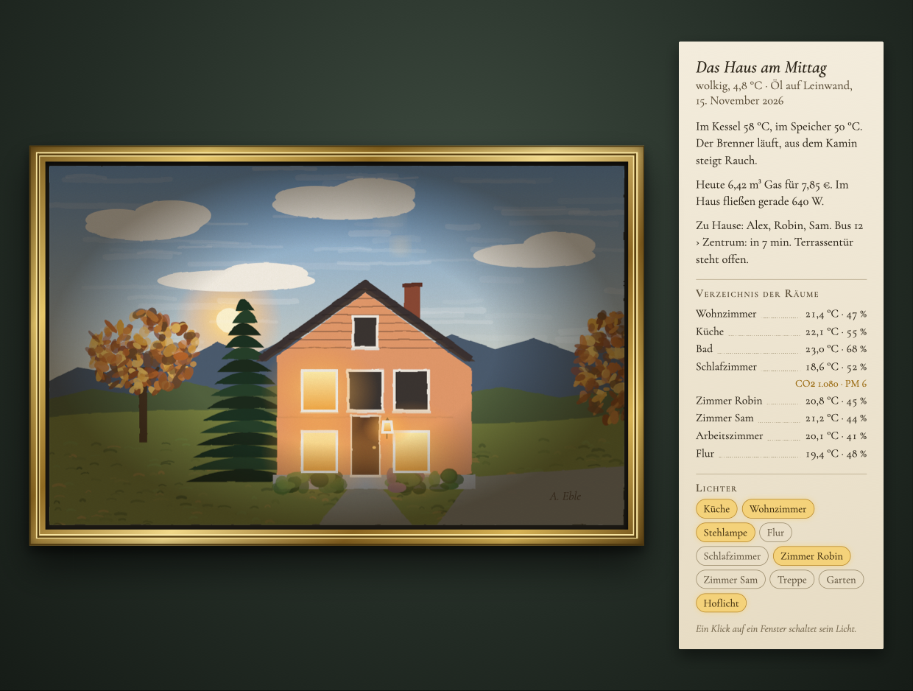

# Gemälde



Das Haus als Ölbild in einem Goldrahmen, daneben ein Museumsschild mit den Werten des Hauses.

- Himmel nach Sonnenstand (`sun.sun`) und Wetter: Morgenrot, Tag, Dämmerung, Sterne und Mond, Regen und Schnee.
- Fenster leuchten, wenn ihre Lampe an ist. Ein Klick auf ein Fenster schaltet sie.
- Läuft der Brenner, steigt Rauch aus dem Kamin.
- Das Schild nennt Tageszeit, Wetter, Heizung, Gas, Strom, Anwesende und Abfahrten und führt alle Räume und Lampen auf.

## Haus

Das gemalte Haus lässt sich unter `house` einstellen. Ohne Angaben ist es zweigeschossig mit drei Fensterachsen, Tür in der Mitte, Giebelfenster und Kamin rechts.

```yaml
house:
  floors: 3              # Geschosse, 1 bis 4
  axes: 5                # Fensterachsen, 2 bis 6
  door: 2                # Achse der Haustür, von links gezählt
  attic: true            # Giebelfenster
  chimney: left          # left, right oder false
  cellar: true           # Kellerfenster im Sockel
  wall: "#d9c7a3"        # Fassade
  roof: "#463a36"        # Dach
```

## Fenster

`windows` ordnet jedem Fenster eine Lampe zu. Die Fenster heißen `w<Geschoss>_<Achse>`, das Erdgeschoss ist 0, die Achsen zählen von links ab 1. Kellerfenster heißen `c_<Achse>`. Dazu kommen `attic`, `door` und `lantern`. Mehrere Fenster dürfen dieselbe Lampe haben, nicht genannte bleiben dunkel.

```yaml
windows:
  w0_1: light.kueche           # Erdgeschoss links
  w0_3: light.wohnzimmer       # Erdgeschoss rechts
  w1_1: light.zimmer_robin     # 1. Obergeschoss links
  w1_3: light.schlafzimmer
  c_1: light.keller            # Kellerfenster links
  attic: light.dachzimmer      # Giebelfenster
  door: light.flur             # Haustür
  lantern: light.hoflicht      # Laterne neben der Tür
```

Zusätzlich: `painting_title` (Standard „Das Haus“).

## Konfiguration

Alle Karten teilen sich dieselben Schlüssel. Was fehlt, wird ausgeblendet oder als „–“ angezeigt.

```yaml
type: custom:painting-card
title: Haus
outside_temperature: sensor.aussen_temperatur
outside_humidity: sensor.aussen_feuchte
weather: weather.forecast_home        # Zustand und Ersatz für die Außentemperatur
flame: binary_sensor.brenner_flamme   # Heizung, optional
boiler: sensor.kesseltemperatur
hot_water: sensor.warmwassertemperatur
gas_today: sensor.gas_heute
gas_cost: sensor.gaskosten_heute
power: sensor.hausleistung            # W
download: sensor.wan_download         # optional, Einheit wird nach Mbit/s umgerechnet
upload: sensor.wan_upload
battery_threshold: 20                 # Batteriesensoren darunter werden gemeldet
idle_timeout: 300                     # Ruhemodus nach so vielen Sekunden ohne Berührung (weglassen = aus)
idle_wake:                            # optional, hält das Dashboard wach, solange aktiv
  - binary_sensor.kueche_praesenz
rooms:
  - name: Wohnzimmer
    temperature: sensor.wohnzimmer_temperatur
    humidity: sensor.wohnzimmer_feuchte
    co2: sensor.wohnzimmer_co2            # optional, ppm; gelb ab 1000, rot ab 1200
    pm25: sensor.wohnzimmer_pm25          # optional, µg/m³; gelb ab 15, rot ab 35
lights:
  - name: Küche
    entity: light.kueche
departure:                            # optional, Sensor mit Zeitstempel der nächsten Abfahrt
  name: Linie 3 › Stadt
  entity: sensor.naechste_abfahrt
  delay: sensor.verspaetung
contacts:                             # optional, Fenster und Türen
  - name: Fenster Bad
    entity: binary_sensor.fenster_bad
```

Der Ruhemodus legt ein schwarzes Bild mit schwacher Uhr über das Dashboard; Antippen weckt es, ohne darunter etwas zu schalten. Die Helligkeit des Tablets selbst lässt sich aus dem Browser nicht steuern. Solange er aktiv ist, stehen alle Animationen still und die Karte zeichnet nur alle 30 Sekunden neu; das entlastet ältere Tablets.

Personen kommen automatisch aus allen `person.*`-Entitäten, schwache Batterien aus allen Sensoren mit `device_class: battery`.

## Einbau

Über HACS als benutzerdefiniertes Repository (Typ Dashboard) oder von Hand: `painting-card.js` nach `/config/www/` kopieren und unter Einstellungen → Dashboards → Ressourcen als JavaScript-Modul `/local/painting-card.js` eintragen.

Unten rechts steht eine dezente Signatur; `signature: false` blendet sie aus.

Die Karte ist für eine Panel-Ansicht gedacht (`panel: true`), damit sie den ganzen Bildschirm füllt.

```yaml
views:
  - title: Haus
    panel: true
    cards:
      - type: custom:painting-card
        # Konfiguration wie oben
```

Schriften kommen von Google Fonts. Ohne Internetzugang fällt die Karte auf Systemschriften zurück.

## Lizenz

Apache License 2.0, Copyright 2026 Axel Eble. Wer die Karte weitergibt oder verändert, liefert `LICENSE` und `NOTICE` mit.
